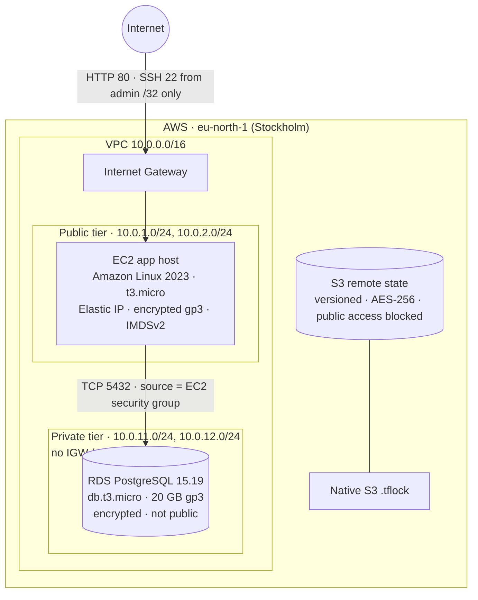
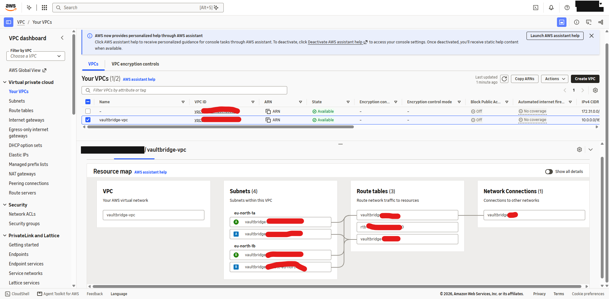
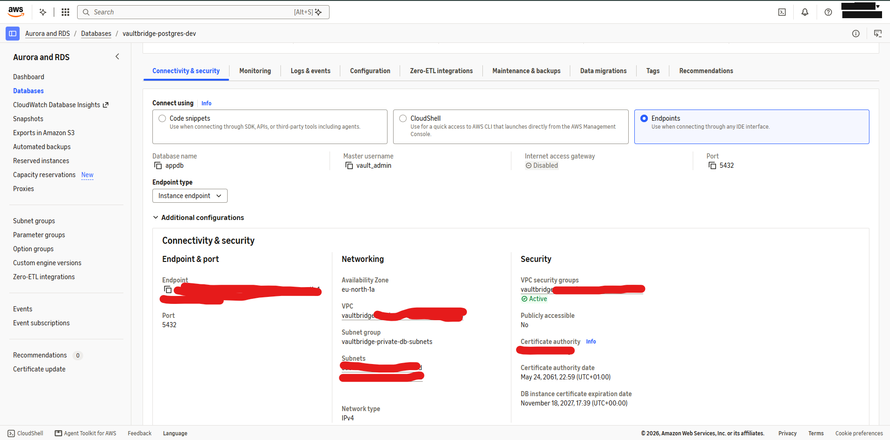
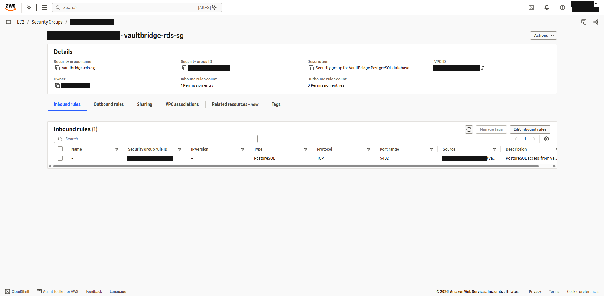
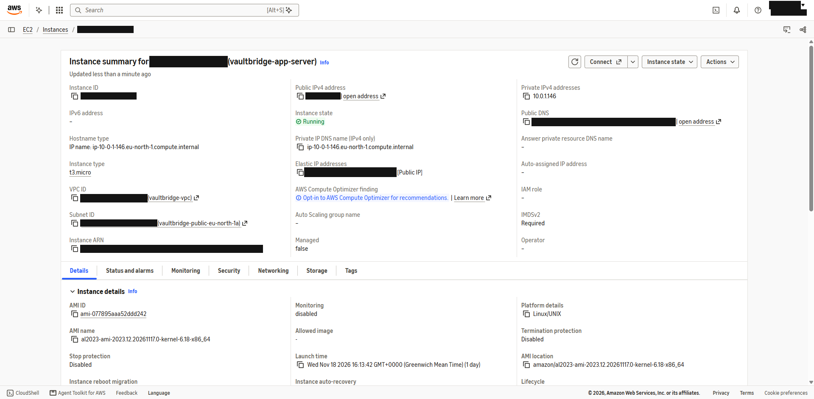
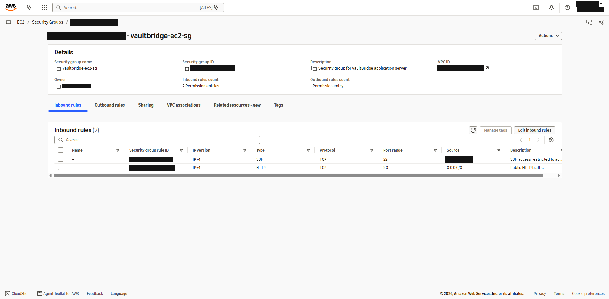
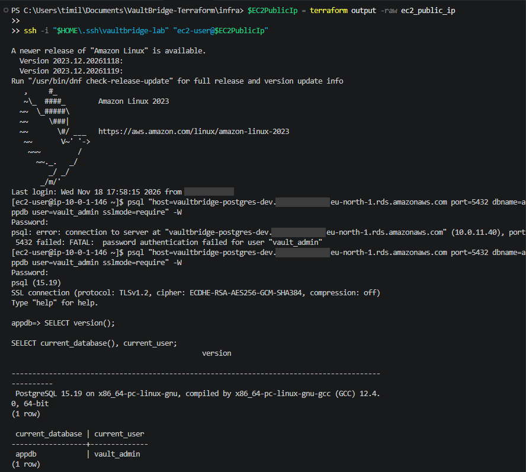
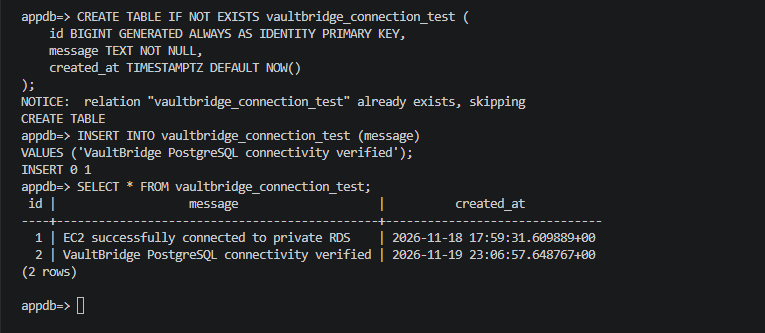
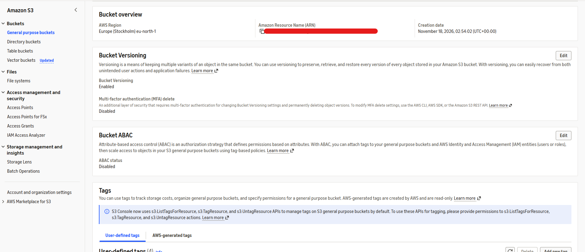
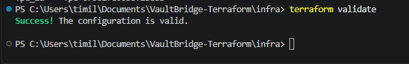

# VaultBridge — Secure AWS Infrastructure as Code with Terraform


> Replacing click-ops with version-controlled, reviewable Terraform: a two-tier AWS network with a private, encrypted database and a locked-down remote state.

---

## The incident this project responds to

**VaultBridge Financial Technologies** is a fictional fintech case study, headquartered in Lagos and operating across Nigeria, Kenya, Ghana and Rwanda. Its application code was version-controlled, but its AWS infrastructure was changed by hand in the console.

In the scenario, an engineer's manual security-group change in **November 2023** exposed **PostgreSQL port 5432 to the internet**. Automated scanners found the open port, and the emergency response caused an outage:

| Impact | |
|---|---|
| Downtime | **4 h 12 min** |
| Transactions affected | **~47,000** |
| Estimated business loss | **~US$214,000** |

The root cause was not the single bad rule. It was that infrastructure changes had **no review, no history and no repeatable baseline**. This project fixes that with Terraform.

---

## Objectives

- [x] Define all infrastructure in version-controlled Terraform. No console changes.
- [x] Store state remotely in S3, with versioning, encryption and **native S3 state locking**
- [x] Put the database in **private subnets with no route to the internet**
- [x] Allow database access **only from the application tier's security group**, never a CIDR
- [x] Encrypt EC2 and RDS storage at rest
- [x] Enforce a `fmt → validate → plan → review → apply` workflow
- [x] Prove the result: connectivity, encryption, isolation and zero drift

---

## Architecture



| Tier | Subnet | CIDR | AZ |
|---|---|---|---|
| Public | Public A | 10.0.1.0/24 | eu-north-1a |
| Public | Public B | 10.0.2.0/24 | eu-north-1b |
| Private | Private A | 10.0.11.0/24 | eu-north-1a |
| Private | Private B | 10.0.12.0/24 | eu-north-1b |

**Inventory:** the `infra/` workspace manages 25 resources (network 12, security 6, compute 4, database 3). The `bootstrap/` workspace manages 6 (state bucket and its protections).

---

## Security controls

### Network

| Control | Implementation | File |
|---|---|---|
| Database never internet-reachable | RDS in private subnets, `publicly_accessible = false`, private route table has no IGW/NAT route | `rds.tf`, `vpc.tf` |
| Least-privilege DB access | 5432 ingress references the **EC2 security group ID**, not an IP range. This directly prevents the incident scenario | `security_groups.tf` |
| Restricted admin access | SSH only from `my_ip_cidr`, with a variable validation that **rejects anything that isn't a /32** | `variables.tf` |
| HTTP | Port 80 open as required by the brief (no app deployed in the lab) | `security_groups.tf` |

### Compute & data

| Control | Implementation |
|---|---|
| Encryption at rest | EC2 root volume: encrypted gp3. RDS: `storage_encrypted = true` |
| Encryption in transit | DB connection tested with `sslmode=require`; TLS 1.2 negotiated |
| Instance metadata | **IMDSv2 required**, hop limit 1 (mitigates SSRF credential theft) |
| DB audit | Parameter group with `log_connections = 1` |
| Secrets | DB username and password marked `sensitive` and supplied through `TF_VAR_` environment variables. Never in `.tfvars` or git |

### Terraform state & guardrails

| Control | Implementation |
|---|---|
| Remote state | S3 with versioning, AES-256 SSE, all public access blocked, `BucketOwnerEnforced` |
| State locking | Native S3 lockfile (`use_lockfile = true`), no DynamoDB table needed |
| Wrong-account protection | `allowed_account_ids` on every provider |
| Nothing sensitive committed | `.gitignore` excludes state, plans, real `tfvars`, `backend.hcl`, keys |
| Provenance | Default tags on every resource: `Project`, `Environment`, `ManagedBy = Terraform` |

---

## Validation evidence

| Check | Observed result |
|---|---|
| EC2 | Running, reachable over SSH, cloud-init `done`, `psql` 15.19 installed |
| IMDSv2 | Token-based metadata request returned the instance ID |
| RDS | `available`; public access `false`; storage encrypted; 20 GB gp3 |
| Security groups | SSH limited to /32; 5432 sourced only from EC2 SG |
| App → DB | EC2 connected to private RDS over **TLS 1.2**; test table created, row written and read back |
| Remote state | `envs/dev/terraform.tfstate` present in S3; 25 resources in state |
| Drift | `terraform validate` passes; final `plan` reports **no changes** (both workspaces) |

### Screenshots

**Network:** VPC with 2 public and 2 private subnets across eu-north-1a/1b, 3 route tables and an Internet Gateway


**Database isolation:** RDS is not publicly accessible, sits in the private DB subnet group, and 5432 is only open to the EC2 security group
| | |
|---|---|
|  |  |

**App host:** t3.micro, IMDSv2 required, SSH limited to a single admin /32, HTTP 80 public
| | |
|---|---|
|  |  |

**End-to-end test:** EC2 → private RDS over TLS 1.2, then a write and a read
| | |
|---|---|
|  |  |

**State and config:** versioned S3 state bucket; `terraform validate` passes
| | |
|---|---|
|  |  |

<sub>Account ID, resource IDs, IP addresses and the RDS endpoint are redacted.</sub>

---

## Repository structure

```
.
├── bootstrap/                 # Creates the S3 state bucket (local state; the chicken-and-egg step)
│   ├── main.tf
│   ├── variables.tf
│   ├── outputs.tf
│   └── terraform.tfvars.example
├── infra/                     # Main workload (remote state in S3)
│   ├── backend.tf             # Empty S3 backend, configured via backend.hcl
│   ├── backend.hcl.example
│   ├── providers.tf
│   ├── variables.tf
│   ├── vpc.tf                 # VPC, 4 subnets, IGW, route tables
│   ├── security_groups.tf     # EC2 + RDS security groups and rules
│   ├── ec2.tf                 # App host, key pair, Elastic IP
│   ├── rds.tf                 # Subnet group, parameter group, PostgreSQL
│   ├── outputs.tf
│   └── terraform.tfvars.example
└── .gitignore
```

---

## Deploy it

**Prerequisites:** Terraform ≥ 1.5, AWS CLI v2, OpenSSH, and an AWS CLI profile named `vaultbridge-lab` (or change `profile` in the provider and backend).

```powershell
# 1. SSH key (private key never leaves your machine)
ssh-keygen -t rsa -b 4096 -f "$HOME\.ssh\vaultbridge-lab" -C "vaultbridge-lab"

# 2. Bootstrap the state bucket
cd bootstrap
Copy-Item terraform.tfvars.example terraform.tfvars    # set allowed_account_id
terraform init; terraform validate
terraform plan -out bootstrap.tfplan; terraform apply bootstrap.tfplan
terraform output -raw state_bucket_name

# 3. Point the main workspace at it
cd ..\infra
Copy-Item backend.hcl.example backend.hcl              # paste the bucket name
Copy-Item terraform.tfvars.example terraform.tfvars    # account ID, your IP /32, public key path
terraform init -reconfigure -backend-config="backend.hcl"

# 4. DB credentials via environment only
$env:TF_VAR_db_username = "vault_admin"
$secure = Read-Host "PostgreSQL password" -AsSecureString
$bstr = [Runtime.InteropServices.Marshal]::SecureStringToBSTR($secure)
try { $env:TF_VAR_db_password = [Runtime.InteropServices.Marshal]::PtrToStringBSTR($bstr) }
finally { [Runtime.InteropServices.Marshal]::ZeroFreeBSTR($bstr) }

# 5. Review, then apply
terraform fmt -recursive; terraform validate
terraform plan -out deployment.tfplan                 # read it: account, region, CIDRs, SG rules
terraform apply deployment.tfplan
```

Verify from EC2:

```bash
psql "host=<rds_address> port=5432 dbname=appdb user=vault_admin sslmode=require" -W
```

**Teardown order matters:** run `terraform destroy` in `infra/` first, verify it, then empty the versioned state bucket, and only then destroy `bootstrap/`.

---

## Decisions & deviations from the brief

| Brief | Implemented | Why |
|---|---|---|
| eu-west-1 (Ireland) | eu-north-1 (Stockholm) | Region assigned to the AWS account used |
| DynamoDB table for locking | Native S3 lockfile | Terraform's built-in S3 locking removes an extra resource |
| PostgreSQL 15.4 | PostgreSQL 15.19 | 15.19 was orderable with the chosen class and gp3 in-region |

## Troubleshooting log (what actually went wrong)

- Typo in the provider source (`harshicorp` instead of `hashicorp`) blocked `init`
- An **empty `ec2.tf`** caused a plan with no EC2 changes. I caught it by reading the plan, not just the summary
- Restored `associate_public_ip_address` to avoid an unnecessary EC2 **replacement**
- RDS create failed because `TF_VAR_db_username` wasn't set in the session
- Windows AWS CLI pager hung scripts. Fixed with `$env:AWS_PAGER=""` / `--no-cli-pager`

**Lessons:** bootstrap state has to live separately from the backend it creates. Always read a plan for `replace`/`destroy`, not just the counts. And a deployed resource isn't "done" until connectivity, encryption and drift have been verified.

---

## Production roadmap

| Area | Lab | Production |
|---|---|---|
| DB availability | Single instance (subnet group spans 2 AZs) | Multi-AZ with tested failover |
| Secrets | `sensitive` variables via env | AWS Secrets Manager with rotation |
| Admin access | SSH from one /32 | SSM Session Manager, no inbound 22 |
| Backups | RDS defaults, final snapshot skipped | Retention policy, restore drills |
| Monitoring | Connection logging | CloudWatch alarms, log exports, runbooks |
| Pipeline | Manual plan/apply | CI with `tflint`, Checkov/tfsec, approval-gated apply |
| Structure | One environment | Reusable modules, per-environment state |

---

**Skills shown:** Terraform · AWS networking (VPC, subnets, routing, security groups) · RDS · remote state & locking · secrets hygiene · secure-by-default IaC · incident-driven design

*Fictional case study built in a personal AWS lab. Account IDs, IPs, endpoints and bucket names are intentionally not published.*
